# The puregrain logo

Made by puregrain itself: its dots come from puregrain's ordered
dithering, in the colors of the ZX Spectrum and the Commodore 64. It
isn't under the MIT License of the code; what it may be used for is in
[LICENSE.md](LICENSE.md).

## Overview

Two color sets, with the same file names: `zx/`, in the ZX Spectrum's
red and green, and `c64/`, in the C64's orange and blue.

| | `zx/` | `c64/` |
|---|---|---|
| lockup | 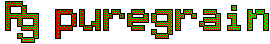 | 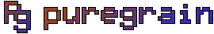 |
| mark | 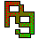 | 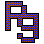 |
| wordmark | 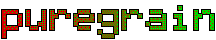 | 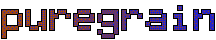 |
| swash | 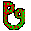 | 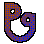 |

And for the web, in the ZX set: `icon.svg` at 4 times, the touch icon,
and the social preview at half its size.

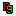 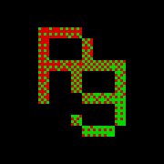

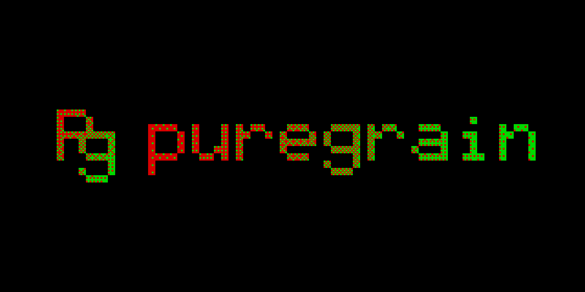

## Which set to use

The two sets are equal: use the one that fits the colors and style
around the logo. A recommendation, from the colors' contrast: on dark
backgrounds, the ZX set. There the black outline disappears into the
background and the colors carry the shape alone, and the C64's blue
fades. On light backgrounds both work, the C64 set even better: its
colors have the most contrast there, while the ZX green relies on the
outline.

| Contrast against | black | GitHub's dark page | white |
|---|---:|---:|---:|
| ZX red `#d80000` | 3.92 | 3.53 | 5.36 |
| ZX green `#00d800` | 10.82 | 9.75 | 1.94 |
| C64 orange `#9f4815` | 3.41 | 3.07 | 6.15 |
| C64 blue `#2724c4` | 2.14 | 1.92 | 9.83 |

These are WCAG contrast ratios: 1 means none, 21 is black on white;
WCAG asks 3 of graphics, though logos are exempt. GitHub's dark page is
`#0d1117`.

Where one picture has to work on any background, the files use the ZX
set: the favicon, shown in light and dark tab bars, the touch icon, and
the social preview.

## The files

| Name | What | Size |
|---|---|---:|
| `lockup` | The long logo: the mark beside the wordmark | 270 × 44 |
| `mark` | The short logo, "Pg": the P and the g share a corner | 44 × 44 |
| `wordmark` | The word, in the logo's pixel font | 216 × 40 |
| `swash` | "Pg", the P's stem sweeping into the g's tail: an extra for special and fun uses, not a second mark | 44 × 44 |

Each comes as an SVG, a PNG at its size, and a PNG four times as large
(`@4x.png`). And for the web, in the ZX set:

| File | What |
|---|---|
| `favicon.ico` | The browser tab's icon: the mark at 16, 32 and 48 pixels. At 16 its strokes are 1 pixel wide, too thin for a gradient, so the P is plain red and the g plain green. |
| `icon.svg` | The same 16-pixel icon as an SVG |
| `apple-touch-icon.png` | 180 × 180, on black: the icon on iPhones' and iPads' home screens |
| `social-preview.png` | 1280 × 640, on black: the picture shown when the repository's link is shared; set by hand in the repository's settings (Settings → General → Social preview) |

The web UI's build copies the three icons into the page. All four
browsers the web UI supports take `icon.svg` for the tab: Chrome and
Edge since version 80, Firefox since 41, Safari since 26. Drawn anew at
any pixel ratio, it stays sharp; on a screen of double density each of
its pixels becomes 2 × 2. The ICO serves older browsers and tools that
read only `favicon.ico`. It holds plain bitmaps, uncompressed, so its
bytes don't depend on Node's zlib; with PNGs inside, it would be about
1.5 KB instead of 15.

## Using it

- **Scale by whole numbers,** 2, 3 or 4 times, with nearest-neighbour
  scaling, so that every dot stays a square; at any other scale the dots
  blur. The SVGs stay sharp at any size, at whole multiples best: for
  example `` for twice the size.
- **On any background:** the black outline keeps the logo clear on white
  and on dark backgrounds; on black it disappears into the background.
  Which set suits which background: see above.

## How it's made

[make-logo.mjs](make-logo.mjs) draws everything:

1. **The shapes:** the letters of a 5 × 9 pixel font, in cells of 4
   pixels, with a margin of 2 for the outline. The mark puts a capital P
   at the top left and the font's g at the bottom right of a grid of
   10 × 10 cells, so that the bottom bar of the P's head runs into the
   g's top bar. The swash is drawn from rings and boxes, sampled 4 × 4
   times per pixel.
2. **The dots:** under each shape a gray gradient, from 20 to 235, along
   the diagonal for the mark and the swash and from left to right for
   the wordmark, dithered by puregrain's command-line tool to two levels
   with a Bayer map: `--levels 2 --bayer 4 --kernel none --gray`, with
   `--bayer 8` for `c64/`. The dark dots take the set's first color, the
   light ones its second: ZX red `#d80000` and green `#00d800`, C64
   orange `#9f4815` and blue `#2724c4`, the values of puregrain's
   palettes. It takes these two steps because the tool can't use a
   Bayer map with a palette: the gray says how far each pixel lies from
   the first color towards the second. (Doing it in one step is an idea
   in [TODO.md](../TODO.md).)
3. **The outline:** black, every pixel touching the letters, diagonally
   too, around the holes as well.

The SVGs have a rectangle for each run of a color along a row, so they
draw the PNGs' pixels exactly.

## Making it again

```bash
npm run build   # the command-line tool that the script runs
npm run logo
```

The script gives every setting it dithers with, so a change of the
tool's defaults can't change the logo. It writes a file only when its
pixels changed, since another version of Node may compress the same
pixels to other bytes: after a run, `git status` lists only real changes.
