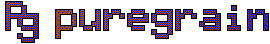

# 

Dithering for PNG images on the command line: error diffusion with 11
kernels (Floyd–Steinberg, Atkinson, Jarvis–Judice–Ninke and more),
ordered (Bayer) dithering, retro palettes, a choice of gamma, and the
screens of the ZX Spectrum and the Commodore 64, written as the
machines' own files.

It gives the same pixels as [puregrain lab](https://roman-mkh.github.io/puregrain/),
the same dithering in the browser, and the machines' files byte for byte.

## Run it

Needs Node.js 22 or later. Without installing anything:

```bash
npx puregrain photo.png out.png --palette c64
```

Or install the `puregrain` command:

```bash
npm install --global puregrain
```

## Examples

```bash
# 1-bit black and white, with Floyd–Steinberg (a color picture is turned gray first)
puregrain photo.png bw.png

# 4 levels per color channel, with Atkinson
puregrain photo.png levels.png --levels 4 --kernel atkinson

# ordered dithering with the 4×4 Bayer map
puregrain photo.png bayer.png --bayer 4

# a ZX Spectrum screen, as the Spectrum's own screen file (from a 256×192 picture)
puregrain screen.png screen.scr --machine zx-spectrum --bayer 2

# a Commodore 64 program that shows the picture (from a 320×200 picture)
puregrain screen.png screen.prg --machine c64-hires --bayer 2
```

View the results at 100% zoom: any other zoom blurs the dots or adds
patterns that aren't in the file. `puregrain --help` lists the options;
what each does, with more examples:
[the command-line tool's documentation](https://github.com/roman-mkh/puregrain/blob/master/cli/README.md).

## More

- [puregrain lab](https://roman-mkh.github.io/puregrain/): the same
  dithering in the browser, with nothing to install.
- [The library](https://pursuit.purescript.org/packages/purescript-puregrain),
  for dithering inside PureScript programs.
- [Source, docs and issues](https://github.com/roman-mkh/puregrain).

## License

[MIT](https://github.com/roman-mkh/puregrain/blob/master/LICENSE). The logo
has [terms of its own](https://github.com/roman-mkh/puregrain/blob/master/logo/LICENSE.md).
The command's bundle also contains code compiled from open-source
PureScript packages; their licenses are in the package's
`THIRD-PARTY-NOTICES.txt`.
