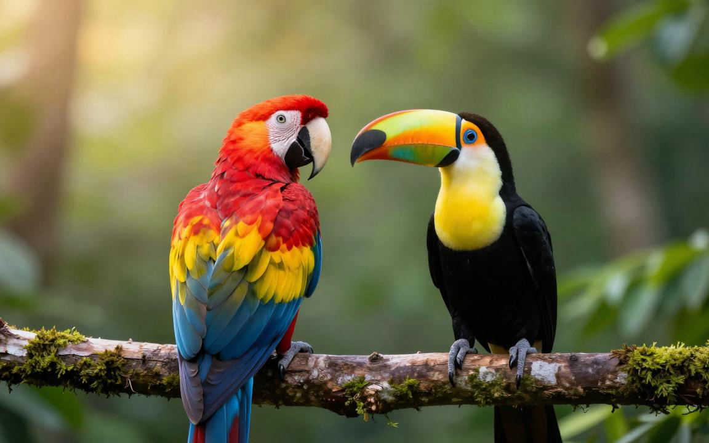

# The sample picture



`macaw-and-toucan.png` (1152 × 720, true color) is a picture to try
puregrain on. It has what shows dithering at its best and at its worst:

- a smooth background, from deep green to warm light, where banding and
  each method's texture show;
- saturated reds, yellows and blues, for the palettes;
- the toucan's black body and the light at the top left, for the darkest
  and lightest tones, where a gamma matters;
- feathers, moss and bark, for fine detail.

## Trying it

From a checkout of this repository (see the command-line tool's
[quick start](../cli/README.md#quick-start)):

```bash
npm run dither-cli -- pictures/macaw-and-toucan.png birds-vga.png --palette cga16 --gamma 1.8
```

With the npm package `puregrain` (from the next release), for Node.js 22
or later, download the picture first:

```bash
curl -LO https://raw.githubusercontent.com/roman-mkh/puregrain/master/pictures/macaw-and-toucan.png
npx puregrain macaw-and-toucan.png birds-vga.png --palette cga16 --gamma 1.8
```

Both give the picture in the IBM PC's 16 colors, dithered with
Floyd–Steinberg. `--gamma 1.8` mixes the dots by their light; seen here,
at 100% zoom, it came closest to the original. When a gamma helps and when
it doesn't: [docs/gamma.md](../docs/gamma.md).

In [puregrain lab](https://roman-mkh.github.io/puregrain/), without
installing anything: "try the sample picture", before you choose a
picture of your own.

## Where it comes from

Generated by [Lumo, Proton's AI assistant](https://proton.me/lumo), on
2026-11-21, from this prompt:

> A realistic wildlife photograph of a scarlet macaw and a keel-billed
> toucan sitting side by side on a mossy branch in a tropical rainforest.
> Soft morning sunlight from the upper left, so each bird has a lit side
> and a shaded side. The background is a softly blurred jungle, a smooth
> gradient from deep green at the bottom to warm golden light at the top,
> with a few out-of-focus circles of light. Vivid, saturated colors: the
> macaw's red, yellow and blue feathers, the toucan's black body, pale
> yellow throat and large orange-green bill. Sharp detail in the feathers
> and the eyes. Both birds fully in the frame, centered, filling the
> middle two thirds of the picture, with space around them. Landscape
> format, 16:10. No text, no watermark, no border, no people.

Lumo made a 1280 × 720 JPEG: 16:9, since it offers no 16:10. Its 64
leftmost and 64 rightmost columns were cut away, which leaves 16:10, and
the rest was stored as a PNG, without loss. Nothing else was changed: the
JPEG's compression is still in it. A PNG because browsers may decode the
same JPEG to slightly different pixels, while a PNG decodes to the same
pixels everywhere, so every client dithers the same picture.

## License

MIT, like the rest of the repository: see [LICENSE](../LICENSE). Lumo's
terms give its output to the person who asked for it. In some countries a
picture made by an AI has no copyright at all; there it's free to use
anyway.
